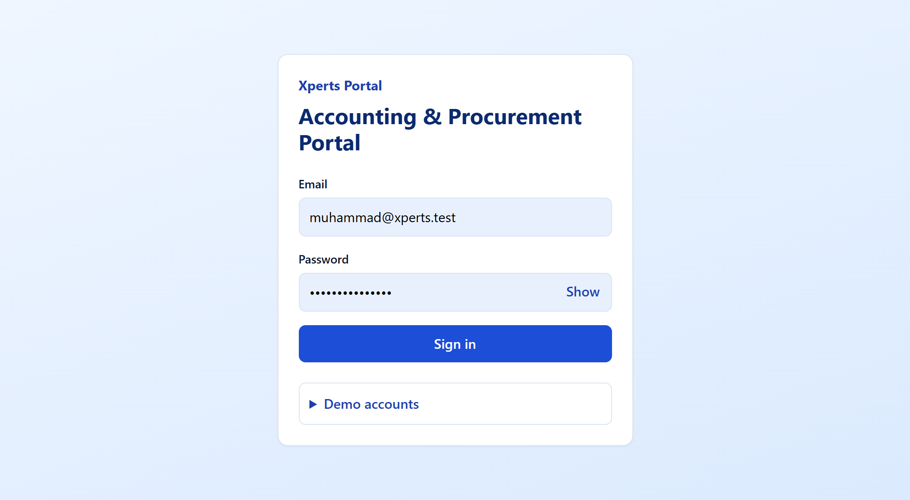
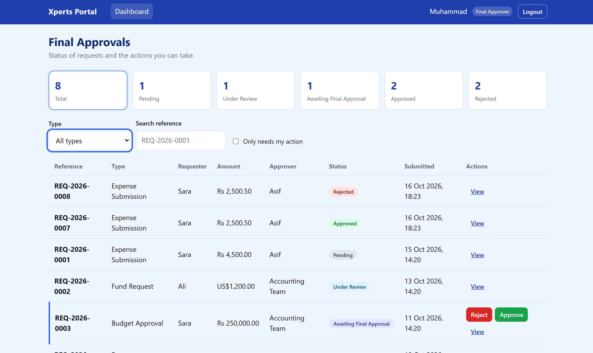
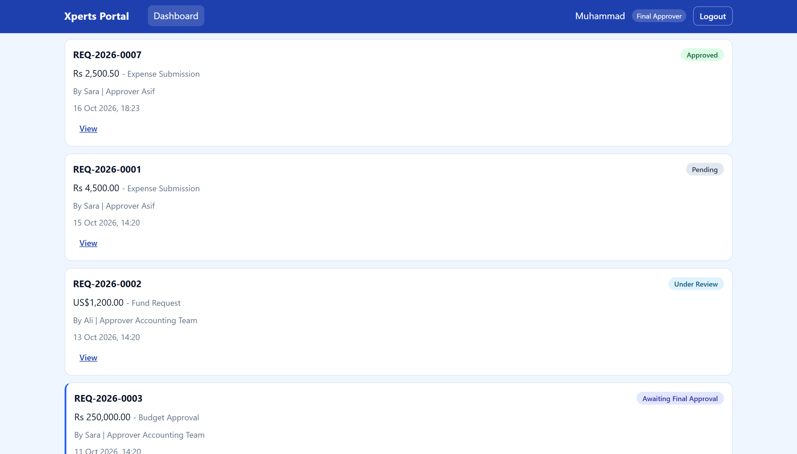
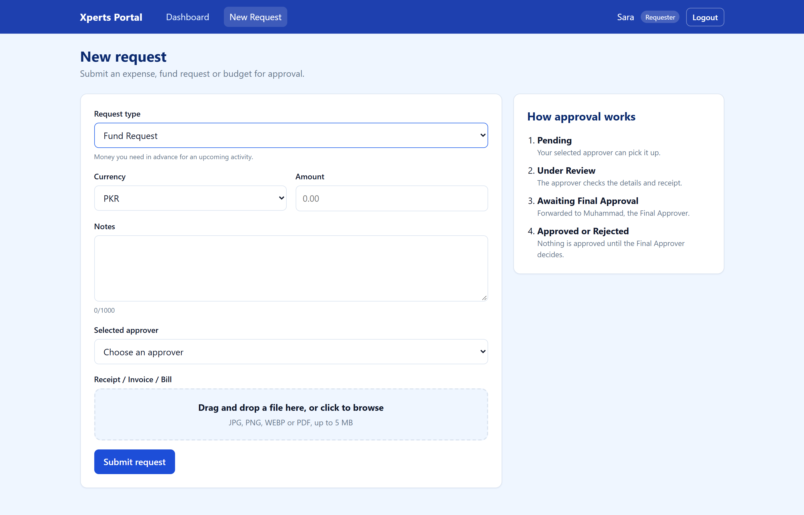
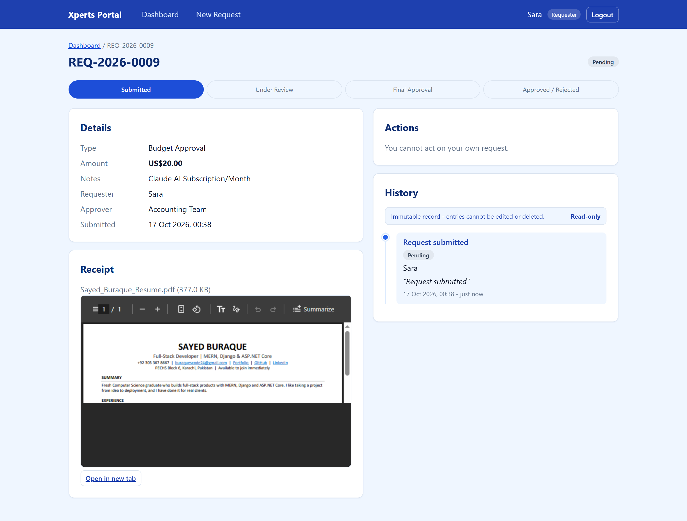
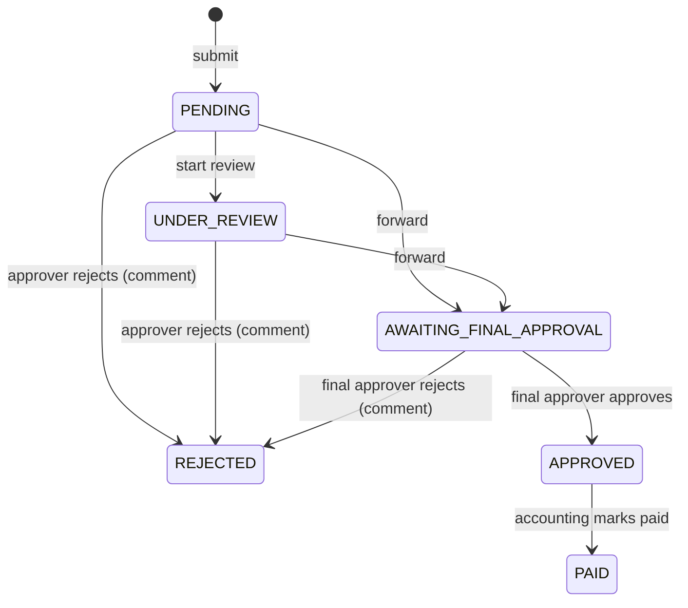
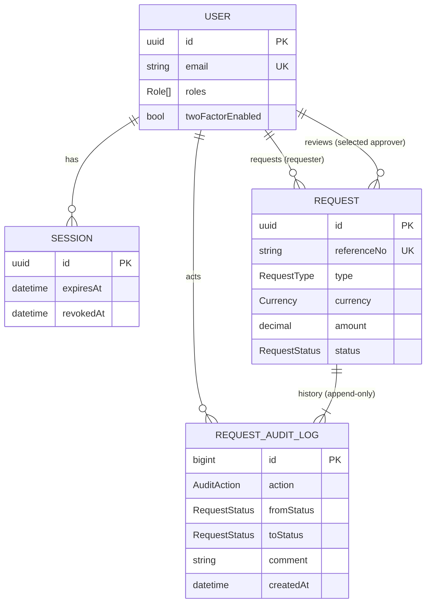

# Accounting & Procurement Portal (Phase 1 MVP)

A request-submission and multi-tier approval portal for Xperts Global. Staff submit Expense, Fund and Budget requests with a receipt; the selected approver can only **reject or forward**; the **Final Approver** (Muhammad) makes the only approving decision. Every status change is written to an append-only audit trail enforced by PostgreSQL itself.

## Screenshots

Stored in `docs/screenshots/`.

| File | What it shows |
|---|---|
| `01-login.png` | Login page with demo accounts open |
| `02-dashboard-approver.png` | Approver dashboard (Asif), action buttons visible |
| `03-dashboard-approver.png` | Approver dashboard, second view |
| `04-new-request.png` | New request form with file attached |
| `05-detail-timeline.png` | Request detail with history timeline and progress stepper |

### Login


### Approver dashboard


### Approver dashboard (second view)


### New request


### Request detail and timeline


## Features
| Assessment item | Implementation |
|---|---|
| Schema (Users/Roles, Requests, Status Log) | `backend/prisma/schema.prisma`, with a trigger migration that blocks UPDATE/DELETE/TRUNCATE on `request_audit_logs` |
| Create request with simulated upload (image/PDF) | `POST /api/requests` (multer disk storage, type/size/magic-byte checks) |
| Approver: Reject or Forward | `POST /api/requests/:id/reject` and `/forward` |
| Final Approver: Approve or Reject | `POST /api/requests/:id/approve` and `/reject` |
| Server-side role validation + immutable log | `workflow.service.js`, `authorize.js`, DB trigger |
| Submit form with attachment | `RequestForm.jsx`, `FileDropzone.jsx` |
| Role-aware approval dashboard | `DashboardPage.jsx` (renders only server-provided `availableActions`) |
| History timeline per request | `HistoryTimeline.jsx`, `ProgressStepper.jsx` |
| Shared login, 2FA-ready, session management | `auth.service.js`, `session.service.js`, `Session` table |
| White and blue responsive UI | `frontend/src/styles/` (plain CSS design tokens) |

## Tech stack
| Layer | Technology |
|---|---|
| Frontend | React 18, Vite, react-router-dom 7, axios, plain CSS |
| Backend | Node.js 20+, Express 5, zod, multer, helmet, express-rate-limit |
| Database | PostgreSQL 16 (Docker), Prisma 6 |
| Auth | bcryptjs, JWT in an httpOnly cookie, server-side `Session` table |
| Tests | vitest, supertest |

## Architecture choices
- **Layered MVC**: `routes -> controllers -> services -> repositories -> Prisma`. Controllers only handle HTTP, services own business rules and never see `req/res`, repositories hold all queries. This keeps rules testable and easy to explain.
- **Declarative workflow table** (`backend/src/config/workflow.js`): the only place that defines transitions. `REJECT` resolves to `APPROVER_REJECT` or `FINAL_REJECT` depending on the current status.
- **Sessions**: the cookie holds a JWT (`sub`, `sid`), but it is honoured only while its `Session` row exists, is not revoked, is not expired and the user is active. Logout therefore ends the session immediately. The JWT algorithm is pinned to HS256.
- **Transactions**: every status change updates the request and inserts the audit row in one `prisma.$transaction`. Creating a request and its first audit row is also one transaction.
- **Server-computed `availableActions`**: the API tells the UI what the current user may do; the frontend contains no permission logic.
- **2FA-ready**: `User.twoFactorEnabled/twoFactorSecret` exist; login returns `{ requiresTwoFactor, challengeToken }` for such users, and `completeTwoFactor()` is a 501 stub (TOTP is a planned follow-up).

## Security considerations
- **RBAC on the server**: `authorize()` is a coarse route gate; ownership and status rules are enforced again in `workflow.service.js`. The UI is never trusted.
- **No self-approval**: a requester can neither pick themselves as approver nor act on their own request.
- **Optimistic concurrency**: `updateMany({ where: { id, status: expected } })`; if two people act at once, the second gets 409.
- **Append-only audit log**: no update/delete code path exists, and a Postgres trigger rejects UPDATE, DELETE and TRUNCATE. Records are never hard-deleted.
- **Passwords and login**: bcrypt (12 rounds), identical error for unknown email and wrong password, dummy hash comparison to equalise timing. Only failed logins are rate limited (5 per 15 min per IP).
- **Scoping (IDOR)**: requester sees own requests; approver sees routed + own; final approver and accounting see all. Out-of-scope access returns 403.
- **HTTP hardening**: helmet, CORS allow-list with credentials, 1 MB JSON limit, general API rate limit, no stack traces in production.
- **Uploads**: MIME allow-list (JPEG/PNG/WEBP/PDF), 5 MB limit, magic-byte check, random UUID file names, extension from MIME not client name, orphan files deleted on failure, path kept inside the upload root, download only via the authenticated endpoint with `nosniff`, `Cache-Control: private, no-store`.
- **DTO whitelist**: responses never include `passwordHash`, `twoFactorSecret`, stored file names or server paths.
- **Secrets**: only in `.env` (git-ignored); `.env.example` has placeholders.

## Roles and permissions
| Action | Requester | Approver (selected) | Final Approver | Accounting |
|---|---|---|---|---|
| Submit request | yes | | | |
| Start review / Forward | | yes | | |
| Reject (Pending / Under Review) | | yes | | |
| Approve / Reject (Awaiting Final) | | | yes | |
| Mark Paid (bonus) | | | | yes |
| Act on own request | never | never | never | never |

A user may hold several roles (for example Asif is Requester + Approver).

### Status machine


### Database ERD


## Prerequisites
Node.js 20+, Git, Docker Desktop (or local PostgreSQL 15+). Free ports: 5432, 4000, 5173.

## Setup and run
```bash
git clone <your-repo-url> accounting-portal && cd accounting-portal
npm install && (cd backend && npm install) && (cd frontend && npm install)

cp backend/.env.example backend/.env       # then set JWT_SECRET to a random 32+ char value
cp backend/.env.example backend/.env.test  # point DATABASE_URL at database accounting_portal_test
cp frontend/.env.example frontend/.env

npm run db:up                              # starts Postgres (docker compose)
(cd backend && npx prisma migrate deploy && npx prisma generate)
npm run db:seed                            # demo users + sample requests (safe to re-run)
npm run dev                                # API http://localhost:4000, web http://localhost:5173
```
The test database `accounting_portal_test` must exist (`docker exec accounting-db psql -U postgres -c "CREATE DATABASE accounting_portal_test"`).

**Demo accounts** (password `Password@123`)
| Email | Roles |
|---|---|
| muhammad@xperts.test | Final Approver |
| asif@xperts.test | Requester, Approver |
| accounting@xperts.test | Approver, Accounting |
| sara@xperts.test | Requester |
| ali@xperts.test | Requester |

**Tests**: `npm test` (backend vitest; the global setup resets the test database with `prisma migrate reset --force`).
**Reset data**: `cd backend && npx prisma migrate reset --force` (re-applies migrations and seeds). Never TRUNCATE manually: the audit trigger blocks it by design.

## API reference
All routes are under `/api`; responses are `{ success, data, meta? }` or `{ success:false, message, errors? }`.
| Method | Path | Who | Purpose |
|---|---|---|---|
| GET | /health | public | liveness check |
| POST | /auth/login | public | login, sets httpOnly cookie |
| POST | /auth/logout | auth | revokes session |
| GET | /auth/me | auth | current user |
| GET | /users/approvers | auth | approver dropdown |
| POST | /requests | REQUESTER | multipart create with `file` |
| GET | /requests | auth | scoped list (status, type, page, limit) + status counts |
| GET | /requests/:id | auth (scoped) | detail, history, availableActions |
| GET | /requests/:id/history | auth (scoped) | audit timeline |
| GET | /requests/:id/file | auth (scoped) | authenticated receipt |
| POST | /requests/:id/start-review | selected APPROVER | Pending -> Under Review |
| POST | /requests/:id/forward | selected APPROVER | -> Awaiting Final Approval |
| POST | /requests/:id/reject | APPROVER / FINAL_APPROVER | -> Rejected (comment required) |
| POST | /requests/:id/approve | FINAL_APPROVER | -> Approved |
| POST | /requests/:id/mark-paid | ACCOUNTING | -> Paid (bonus) |

## Project structure
```
accounting-portal/
  docker-compose.yml  package.json  README.md  CLAUDE.md
  docs/            architecture.md  api.http  demo-script.md  screenshots/
  backend/
    prisma/        schema.prisma  seed.js  migrations/
    src/           config  routes  controllers  services  repositories
                   middlewares  validators  utils  app.js  server.js
    tests/         unit  api
  frontend/src/    api  context  hooks  routes  pages  components  styles  utils
```

## Scope and roadmap
This MVP is **Phase 1** of the proposal (Modules 1-3).
| # | Proposal module | Status |
|---|---|---|
| 1 | Access and security | Built (login, sessions, roles); 2FA is ready but TOTP is Next |
| 2 | Requests | Built (3 types, PKR/USD, receipt upload) |
| 3 | Approval workflow | Built (reject/forward/final decision, immutable history) |
| 4 | Notifications | Next |
| 5 | Payments | Partial (Mark Paid only; no method/reference/proof) |
| 6 | Procurement records | Next |
| 7 | Dashboard (spending) | Next (current dashboard is the approval queue) |
| 8 | Reports and exports | Next |
| 9 | Admin | Next |
| 10 | Audit viewer and backups | Partial (log is stored and shown per request; no viewer or backups) |

**Intentionally skipped from the proposal**: "Returned for info" step and editing while Pending (adds states beyond the assessment); currencies beyond PKR/USD (needs rate handling); Accounting as a team with first-to-open ownership (modelled as one user); amount-based routing (the proposal default is none); HRMS-wide user directory (local users table instead).

## Assumptions and limitations
- Files are stored on local disk (simulated upload); the sample seed files are placeholders.
- Login rate limiting is in-memory, so it resets on restart and is per process.
- Reference numbers are sequential per year and retried on collision.
- Session cookie `secure` is enabled only in production (HTTPS required).

## What I would do next
TOTP 2FA, email and in-app notifications with reminders, payment details and proof upload, S3-compatible storage, cursor pagination, spending dashboard and exports, Redis-backed rate limiting, CI (lint, test, `npm audit`).
