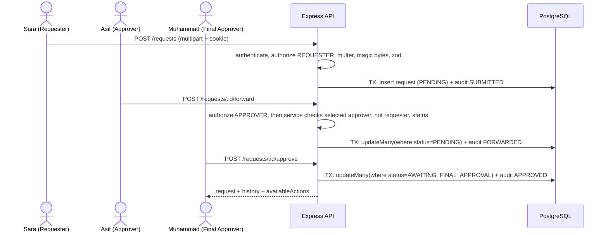

# Architecture

## Request lifecycle: submit -> forward -> approve

## Layer responsibilities
| Layer | Folder | Responsibility | Must not |
|---|---|---|---|
| Routes | `routes/` | URL mapping, middleware order | contain logic |
| Controllers | `controllers/` | parse input, call service, shape response, set cookie | touch Prisma |
| Services | `services/` | business rules, permissions, transactions | touch `req`/`res` |
| Repositories | `repositories/` | Prisma queries only | enforce business rules |
| Config | `config/workflow.js` | the single transition table | be duplicated elsewhere |
| Middlewares | `middlewares/` | authentication, coarse authorization, validation, upload, errors | decide workflow |

## Decision log
| Decision | Why |
|---|---|
| Transition table in one file | One place to read, test and defend the status machine |
| `availableActions` from the server | The UI cannot drift from the rules; no permission logic in React |
| JWT + `Session` table | Stateless token convenience with real revocation on logout |
| httpOnly SameSite=Lax cookie | Script injection cannot read the token; basic CSRF resistance |
| DB trigger on audit table | Immutability holds even if application code is wrong or bypassed |
| Optimistic concurrency via `updateMany` | Prevents double approval without long locks |
| Magic-byte check on uploads | Client MIME type can lie |
| Receipt route relaxes CORP / frame-ancestors | Dev frontend (5173) embeds files from the API (4000); allowed only for `CLIENT_ORIGIN` on this authenticated route |
| Only failed logins rate limited | Demo role switching never hits 429; guessing is still capped |
| Local disk storage | Simulated upload per assessment; S3 is the production path |
